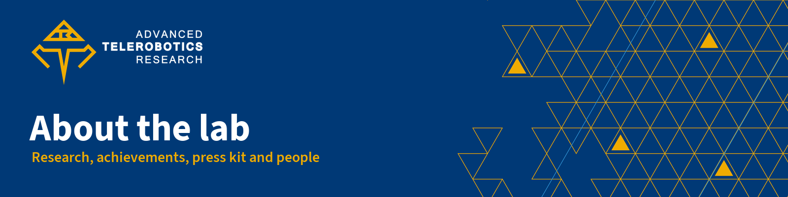

  

  <b>The lab's public profile: what we research, what we have achieved, what we publish, a press kit for reporters and the people in the lab.</b> 
  Advanced Telerobotics Research Laboratory · Department of Computer Science · Kent State University

  
  
  

> The Advanced Telerobotics Research Laboratory at Kent State University is an innovation research laboratory focused on exploring the frontiers of telepresence robotics, tele-embodiment, autonomy and artificial intelligence.

The lab's own published self-description, and the safe default whenever you need one sentence about the lab. Other lengths (most still drafts awaiting the director's approval) are in [press-kit/boilerplates.md](press-kit/boilerplates.md).

## Start here

<table>
  <tr>
    <td width="33%" valign="top">
       
      <b><a href="research.md">Research</a></b> 
      From telepresence to Physical AI: pillars, current projects, platforms and past work.
    </td>
    <td width="33%" valign="top">
       
      <b><a href="achievements.md">Achievements</a></b> 
      A dated timeline of results, in the exact wording we may use.
    </td>
    <td width="33%" valign="top">
       
      <b><a href="publications.md">Publications</a></b> 
      VendoBot at HRI 2026, the awarded papers and a selected list.
    </td>
  </tr>
  <tr>
    <td width="33%" valign="top">
       
      <b><a href="press-kit/README.md">Press kit</a></b> 
      Boilerplates, fact sheet, director bio, logos and photo rules.
    </td>
    <td width="33%" valign="top">
       
      <b><a href="members/README.md">Members</a></b> 
      Who is in the lab, and how members submit their own profile.
    </td>
    <td width="33%" valign="top">
       
      <b><a href="#contact">Contact</a></b> 
      Address, email, website and the lab's verified channels.
    </td>
  </tr>
</table>

## Find what you need

| If you are... | Start with | Then |
|---|---|---|
| A reporter or a Kent State editor | [Press kit](press-kit/README.md) | [Fact sheet](press-kit/fact-sheet.md), [achievements](achievements.md) |
| A prospective student | [Research](research.md) | [Members](members/README.md), [contact](#contact) |
| A lab member | [Members: submit your profile](members/README.md#submit-your-profile) | [Research](research.md) |
| Writing about the lab (news post, slide, grant text) | [Achievements](achievements.md) for the allowed wording | [Boilerplates](press-kit/boilerplates.md) |
| A coding agent | [AGENTS.md](AGENTS.md) | The page your task names |

## At a glance

| Item | Verified value |
|---|---|
| Name | Advanced Telerobotics Research Laboratory, the official long form; then "the lab". Short form in display only: ATR Lab |
| Home | Department of Computer Science, College of Sciences and Humanities, Kent State University, Kent, Ohio |
| Founded | 2017 (the lab opened in spring 2017) |
| Director | Jong-Hoon Kim, associate professor of computer science |
| Focus | Telepresence robotics, tele-embodiment, autonomy and artificial intelligence, moving toward Physical AI (AI that senses and acts in the real world through a robot) |
| Website | [www.atr.cs.kent.edu](https://www.atr.cs.kent.edu/) |

## Highlights

Each line uses the wording the lab may print. Sources and dates are on the [achievements](achievements.md) page.

- **HRI 2026:** VendoBot, published in the HRI 2026 Companion proceedings (Edinburgh, March 2026).
- **World Robot Summit, 2021:** A lab team was selected as one of 11 finalists in the World Robot Summit Plant Disaster Prevention Challenge, the only team from the United States, The Kent Stater reported.
- **NASA SUITS, 2020:** A lab team was selected as one of the top 10 teams for the onsite NASA SUITS challenge.
- **NASA SUITS, 2023:** The lab's ATR_FLUX team built the second generation of AARON, an AR system for spacesuit operations. (AR, augmented reality, lays digital information over the real world.)
- **Paper awards:** Distinguished Paper Award, World Robot Summit Plant Disaster Prevention Challenge (remote participation), awarded to the ATR_Kent team, 2021; Best Conference Paper Award, IHCI 2020 (AARON); Best Paper, Robotics Track, IEMTRONICS 2020; Special Session Best Award, IHCI 2023.
- **World Robot Summit, 2018:** The lab demonstrated TeleBot-2 at the World Robot Summit in Tokyo.
- **On campus:** The lab is a node of Kent State's Design Innovation Hub.
- **Open source:** 55 public repositories on GitHub (ATR-Lab), counted Sept. 30, 2026.

## Current projects and platforms

| Project | What it is | Public code or paper |
|---|---|---|
| VendoBot | A projection-augmented delivery robot for improving intent transparency (showing people what the robot plans to do next) and motion legibility in service robots | [HRI 2026 Companion paper](https://doi.org/10.1145/3776734.3794461) |
| Coffee Buddy | An interactive service robot for coffee shop settings, with voice interaction, facial expressions and head tracking | [ATR-Lab/kami-head](https://github.com/ATR-Lab/kami-head) |
| PepperKit | A SoftBank Pepper robot with a realtime LLM voice agent (an AI language model that listens and answers aloud) | [ATR-Lab/PepperKit](https://github.com/ATR-Lab/PepperKit) |
| Expressive Motion | Expressive walking for a Booster K1 humanoid, learned from video of a person walking (2026) | [ATR-Lab/expressive-motion](https://github.com/ATR-Lab/expressive-motion) |

**Platforms:** SoftBank Pepper, Unitree Go2, Booster K1 humanoid, a Yahboom ROS 2 robot and a robot mower, plus the recent TeleBot generations TeleBot-3R and TeleBot-4R (with an XR interface for Meta Quest). Details and the matching repositories are in [research.md](research.md#platforms).

## Programs

- Undergraduate and graduate courses, including Human-Robot Interaction and Physical AI Agent (CS 4999X and CS 5999Y, to be offered in 2027).
- A summer research internship for high school students (2025 and 2026).
- A summer workshop on Physical AI and robotics for middle school students (2026).

## Contact

| Item | Details |
|---|---|
| Website | [www.atr.cs.kent.edu](https://www.atr.cs.kent.edu/) |
| Mailing address | Department of Computer Science, 241 Mathematical Sciences Building, 1300 Lefton Esplanade, Kent, OH 44242-0001 |
| Department of Computer Science (main office, not a lab line) | 330-672-9980 · [office@cs.kent.edu](mailto:office@cs.kent.edu) |
| Lab location | Mathematical Sciences Building, Room 236 (second floor). Visits by appointment |
| Director's office phone | 330-672-9060 (Jong-Hoon Kim's office line) |
| Director | Jong-Hoon Kim, associate professor of computer science · [jkim72@kent.edu](mailto:jkim72@kent.edu) · [Kent State profile](https://www.kent.edu/cs/jong-hoon-kim) |
| Lab email | [atrlab.kent@gmail.com](mailto:atrlab.kent@gmail.com). For recruiting, K-12 and sponsor questions: [program kent.edu address] |
| Media | Kent State University media relations: [UCM contact]. See the [press kit](press-kit/README.md) |
| X | [@atrlab_kent](https://x.com/atrlab_kent) |
| Instagram | [@atr_lab](https://www.instagram.com/atr_lab/) |
| YouTube | [Advanced Telerobotics Research Laboratory channel](https://www.youtube.com/@advancedteleroboticsresear8565) |
| GitHub | [ATR-Lab](https://github.com/ATR-Lab) |
| LinkedIn | [Advanced Telerobotics Research Laboratory on LinkedIn](https://www.linkedin.com/company/advanced-telerobotics-research-laboratory) |
| Giving | [Giving URL: confirm designation] |

Items in `[brackets]` are not confirmed yet; please don't fill them in from other pages. See [AGENTS.md](AGENTS.md#open-items).

## Repo map

| Path | What it holds | Read it when |
|---|---|---|
| [research.md](research.md) | Positioning, message pillars, projects, platforms, past work, programs | You need to describe what the lab does |
| [achievements.md](achievements.md) | Dated timeline with allowed wording and sources; what never to claim | You mention a result anywhere |
| [publications.md](publications.md) | VendoBot, awarded papers, a selected IEEE-style list | You cite the lab's work |
| [press-kit/](press-kit/README.md) | Boilerplates, fact sheet, director bio, logos, photo rules, coverage log | A reporter, editor or event needs material |
| [members/](members/README.md) | Director entry, member tables, profile form, conversion procedure | You join, leave or update the member list |
| [.github/ISSUE_TEMPLATE/](.github/ISSUE_TEMPLATE/) | Member profile form, docs-fix form, template chooser config | You change how people submit information |
| [AGENTS.md](AGENTS.md) | Rules, sources of truth and open items for coding agents | You (or an agent) edit this repo |

## Contributing

- **Spot a wrong fact or a broken link?** [Open a docs-fix issue](https://github.com/ATR-Lab/about/issues/new?template=docs-fix.yml).
- **Lab member?** [Submit your profile](https://github.com/ATR-Lab/about/issues/new?template=member-profile.yml); see [members/README.md](members/README.md) first.
- **Pull requests** are welcome. Keep the style and facts rules in [AGENTS.md](AGENTS.md) and run its checks before you open one.

## License

Text and code in this repository are released under the [MIT License](LICENSE). The names and logos of the Advanced Telerobotics Research Laboratory and Kent State University are trademarks and are not covered by that license.

The logo files in [press-kit/logos/](press-kit/logos/README.md) are here so people can show the lab's mark correctly; follow the usage rules in that folder. The Kent State University wordmark is not included: get it from [kent.edu/brand/logos](https://www.kent.edu/brand/logos).

---

  <b>ATR Lab docs</b> ·
  <a href="https://github.com/ATR-Lab/about">About the lab</a> ·
  <a href="https://github.com/ATR-Lab/getting-started-atr-lab">Getting started</a> ·
  <a href="https://github.com/ATR-Lab/dev-guidelines">Dev guidelines</a> ·
  <a href="https://github.com/ATR-Lab/all-things-ros2">All things ROS 2</a> ·
  <a href="https://github.com/ATR-Lab">All repositories</a> 
  Advanced Telerobotics Research Laboratory · Department of Computer Science · Kent State University ·
  <a href="https://www.atr.cs.kent.edu/">www.atr.cs.kent.edu</a>

